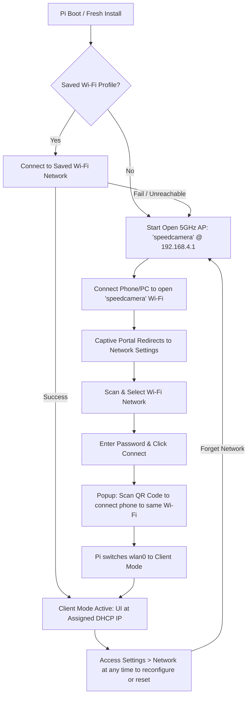

# Speedcamera Headless (Rust & Axum / Socket.io)

A lightweight, high-performance, single-binary speedcamera daemon and responsive web controller written in **Rust** using **Axum 0.8**, **Socketioxide (Socket.io v4)**, **native Aravis C FFI**, **SQLite**, and an embedded **React + Vite** frontend.

Engineered specifically for **Raspberry Pi 5 with Raspberry Pi OS Lite** (zero desktop or GUI dependencies) with ultra-low latency hardware shutter triggering (<10ms) and rock-solid 24/7 reliability. Features an IoT-style onboarding workflow (similar to WLED/ESPHome) with an open 5GHz setup hotspot, captive portal redirection, scannable QR code Wi-Fi onboarding, and dedicated GigE Vision industrial camera networking.

---

## Architecture & Network Operation Modes

```
┌────────────────────────────────────────────────────────────────────────┐
│ Raspberry Pi 5 (Raspberry Pi OS Lite ARM64)                            │
│                                                                        │
│  • eth0 (Camera LAN):    192.168.1.100/24  <── GigE Vision Industrial  │
│                          (or DHCP toggle)      Camera (MTU 9000)       │
│                                                                        │
│  • wlan0 (Wireless):     192.168.4.1/24    <── Open AP Setup Hotspot   │
│                          or DHCP Client IP <── Client Mode (Operation) │
│                                                                        │
│  • speedcamera-rust Daemon (Single Standalone Binary)                  │
│     ├── Axum 0.8 HTTP Server (REST API & Embedded Static Frontend)     │
│     ├── Socketioxide (Socket.io v4 RPC Server & Event Broadcaster)     │
│     ├── Native Aravis C FFI (Direct libaravis-0.8 on eth0)             │
│     ├── Serial Port Reader (serialport @ 115200 baud)                  │
│     ├── Instant Trigger Pipeline (Serial Event -> Camera Shutter <10ms)│
│     ├── SQLite Database (rusqlite WAL mode @ /var/lib/speedcamera)     │
│     └── Pure Rust Poliscan Overlay Renderer (image + imageproc)        │
└───────────────────────┬─────────────────────────────▲──────────────────┘
                        │ Wi-Fi (AP or Client)        │ Ethernet Cable
                        ▼                             │
┌──────────────────────────────────────────┐   ┌──────────────────────────┐
│ Client Device (Phone / Tablet / Laptop)  │   │ Industrial GigE Camera   │
│                                          │   │                          │
│ • Setup: Connect to open "speedcamera"   │   │ • Subnet: 192.168.1.0/24 │
│ • Normal: Access via local router IP     │   │ • GenICam / Aravis 0.8   │
│ • Scannable QR Code Wi-Fi onboarding     │   │ • Jumbo frames (MTU 9000)│
└──────────────────────────────────────────┘   └──────────────────────────┘
```

---

## Network Onboarding Flow (WLED-Style)



1. **Initial / Fallback AP Mode**:
   - Open 5GHz Wi-Fi Hotspot: SSID **`speedcamera`** (No password, Channel 36, IP `192.168.4.1`).
   - Built-in captive portal automatically opens the web dashboard when connecting from iOS, Android, macOS, or Windows.
2. **Wi-Fi Scanner & QR Code Transition**:
   - Open the **Settings > Network** page (icons only, no emojis).
   - Auto-scans nearby 2.4GHz & 5GHz networks with signal strength %, BSSID, channel, and security.
   - Select your Wi-Fi, enter the password, and click **Connect**.
   - A modal displays a **scannable Wi-Fi QR Code** so your smartphone can instantly switch to the same target network.
3. **Client Operation Mode**:
   - The Pi connects to your local router via DHCP and serves the Web UI and API at its assigned IPv4 address.
   - The dedicated Camera LAN on `eth0` remains active at static `192.168.1.100` (MTU 9000).
4. **Internet / Software Updates**:
   - The Pi has internet access via Wi-Fi client mode.
   - If Wi-Fi is not available, the **Network** tab includes an Ethernet toggle to switch `eth0` to standard DHCP for wired internet access.

---

## Key Improvements Over Legacy Daemon

| Feature | Legacy Bun / Electron | **Native Rust Daemon (`headless-rust`)** |
| :--- | :--- | :--- |
| **Runtime** | Bun / V8 JavaScript VM | **Pure native compiled binary (ELF ARM64 / x86_64)** |
| **Memory Footprint** | ~250MB+ | **~15MB** |
| **Camera Integration** | Flawed FFI / unstable wrapper | **Direct C FFI to `libaravis-0.8` (zero intermediate overhead)** |
| **Shutter Latency** | ~50–150ms JS event loop lag | **<10ms Instant Hardware Shutter Pipeline** |
| **Poliscan Skinning** | Heavy native canvas node addons | **Pure Rust `image` + `imageproc` + embedded TTF font** |
| **Frontend Serving** | Node / Bun file serving | **Baked into binary via `rust-embed` (Single binary deployment!)** |
| **Network Management** | Flaky AP password / drops | **Open AP setup + Client mode + QR Code + Captive Portal** |
| **Database** | Bun SQLite bindings | **Native `rusqlite` with WAL mode & foreign keys** |
| **Stability** | Event loop crashes on buffer overflows | **Ring buffer pool + safe Rust error handling + auto-reconnect** |

---

## Deployment

The Pi never compiles anything. CI (or your laptop) cross-compiles an arm64 `.deb`,
and `apt` installs it. The package contains the daemon (`/usr/bin/speedcamera`), its
systemd unit, the network script and a sudoers rule limited to the commands the daemon needs.
Because nothing is downloaded on the Pi during an update, deploying also works while
the Pi is offline in hotspot mode.

All commands below run from `headless-rust/` on your laptop. They need `ssh` and `curl`.
Building the package yourself also needs `podman` or `docker` (the first build takes a
few minutes to prepare the toolchain image; later builds are incremental).

### Fresh Raspberry Pi

1. Flash **Raspberry Pi OS Lite (64-bit)**, Bookworm or newer, with Raspberry Pi Imager.
   In its settings, set the hostname and user, enable SSH and add your home Wi-Fi.
2. Install:
   ```bash
   bun run deploy pi@raspberrypi.local             # build the .deb from this checkout
   bun run deploy pi@raspberrypi.local --release   # or use the latest GitHub release
   ```
   Without the laptop tooling, run this on the Pi instead:
   `curl -fsSL https://raw.githubusercontent.com/LeoLTM/speedcamera/main/headless-rust/packaging/install.sh | sudo bash`
3. The first install needs internet on the Pi once, to fetch `libaravis` and the other
   dependencies. Afterwards, open the Web UI on port 3000 and switch to the setup hotspot
   from **Settings > Network** (or `sudo /usr/lib/speedcamera/setup-network.sh ap`).
   If the Pi has no Wi-Fi connection at boot, the daemon starts the hotspot by itself.

### Updating and rolling back

```bash
bun run deploy pi@raspberrypi.local                   # current working tree
bun run deploy pi@192.168.4.1 --release               # in the field, via the Pi hotspot
bun run deploy pi@raspberrypi.local --release v0.4.0  # roll back to any release
bun run deploy pi@raspberrypi.local --deb ./speedcamera_arm64.deb
```

Set `SPEEDCAMERA_PI=pi@192.168.4.1` (for example) to make that the default target.
Add `--password` if the Pi only accepts password logins.

**Pis set up with the old `install:pi` / `deploy:pi` scripts** need no special steps.
The first `deploy` stops the old git-checkout service and moves `~/.speedcamera`
(database and images) to `/var/lib/speedcamera`. The `~/speedcamera` checkout is
no longer used afterwards and can be deleted.

### Day to day

```bash
bun run pi status pi@raspberrypi.local      # installed version, service state, health
bun run pi logs pi@raspberrypi.local        # follow the daemon log
bun run pi uninstall pi@raspberrypi.local   # keeps data; add --purge to delete it,
                                            # --reset-network to return to plain DHCP
```

| On the Pi | |
| :--- | :--- |
| `/var/lib/speedcamera` | Database and captured images (owned by the `speedcamera` service user) |
| `/etc/default/speedcamera` | Port, bind address, log level, disabled plugins |
| `/usr/lib/speedcamera/setup-network.sh` | Network mode switching (also used by the Web UI) |
| `journalctl -u speedcamera` | Daemon log |

### Releasing

1. Bump `version` in `Cargo.toml`. It is the single version source: the daemon reports it
   in `/api/health` and CI rejects a tag that doesn't match it.
2. Push a tag `vX.Y.Z` (or `vX.Y.Z-canary` for a prerelease). CI attaches the firmware,
   `speedcamera_arm64.deb` and `SHA256SUMS` to a GitHub release.

Every push to `main` also uploads the package as a CI artifact, for trying out unreleased builds:
`gh run download -n speedcamera-deb` and then `bun run deploy <target> --deb speedcamera_arm64.deb`.

---

## Network Script Reference (`setup-network.sh`)

You can inspect or change network modes at any time via the Web UI Settings (**Network** tab) or via CLI:

```bash
# 1. Start Open AP Setup Hotspot (192.168.4.1, no password, captive portal active)
sudo /usr/lib/speedcamera/setup-network.sh ap

# 2. Connect to Wi-Fi network in Client Mode (normal operation)
sudo /usr/lib/speedcamera/setup-network.sh client "MyHomeWiFi" "SecretPassword123"

# 3. Boot auto-mode (reconnects saved client Wi-Fi, falls back to AP if unreachable)
sudo /usr/lib/speedcamera/setup-network.sh auto

# 4. Forget saved Wi-Fi credentials and return to Open AP Setup mode
sudo /usr/lib/speedcamera/setup-network.sh forget

# 5. Set Ethernet interface to dedicated Camera LAN (Static 192.168.1.100, MTU 9000)
sudo /usr/lib/speedcamera/setup-network.sh lan-camera

# 6. Set Ethernet interface to standard DHCP (for wired internet/updates)
sudo /usr/lib/speedcamera/setup-network.sh lan-dhcp

# 7. Scan nearby visible Wi-Fi networks (SSID, BSSID, channel, signal, security)
/usr/lib/speedcamera/setup-network.sh scan

# 8. Revert both Ethernet and Wi-Fi to standard DHCP
sudo /usr/lib/speedcamera/setup-network.sh dhcp

# 9. Check active network status, IP addresses, power management, and internet reachability
/usr/lib/speedcamera/setup-network.sh status
```

---

## Managing the Service on Raspberry Pi

The Speedcamera daemon runs as a `systemd` background service:

```bash
# Check service status
sudo systemctl status speedcamera

# View live streaming logs
sudo journalctl -u speedcamera -f

# Restart service
sudo systemctl restart speedcamera

# Stop service
sudo systemctl stop speedcamera

# Start service
sudo systemctl start speedcamera
```

---

## Local Development & Testing

```bash
cd headless-rust
bun install
bun run build          # web UI into dist/ (embedded into the binary)
cargo run -- --mock    # daemon with simulated camera + serial on :3000
bun run dev            # optional: Vite dev server with hot reload

cargo test             # Rust unit tests
bun run test:integration   # boots the mock daemon; HTTP, Socket.io RPC and live events
bun run package        # build the arm64 .deb into target/debian/
```

- **Web UI:** `http://localhost:3000`
- **Health Endpoint:** `http://localhost:3000/api/health` (includes the running version and commit)
- **Network Endpoint:** `http://localhost:3000/api/network`
- **Socket.io RPC & Events:** `http://localhost:3000/socket.io/`

---

## CLI Options

```
Usage: speedcamera [OPTIONS]

Options:
  -m, --mock                       Run in mock hardware mode (no physical camera/serial required)
  -p, --port <PORT>                HTTP server port (default: 3000)
  -H, --host <HOST>                HTTP server bind address (default: 0.0.0.0)
      --disable-plugins <PLUGINS>  Comma-separated list of plugins to disable (e.g. laptimer,alignment)
  -h, --help                       Print help
```

The same settings can be given as environment variables (`PORT`, `HOST`, `DISABLED_PLUGINS`,
`MOCK_MODE`, `DATA_DIR`, `RUST_LOG`). On the Pi, put them in `/etc/default/speedcamera`.
